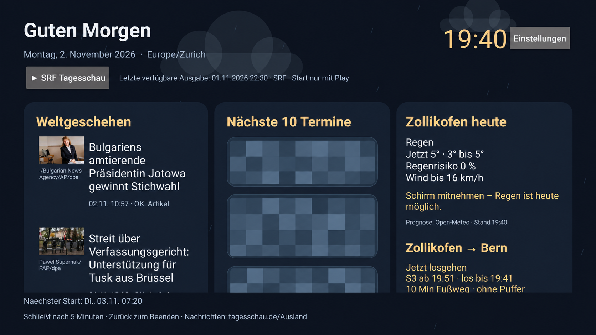

# Morgenblick

Ein persönlicher Morgenüberblick für Android TV: Nachrichten, nächste Kalendertermine, Tageswetter und Schweizer Zugverbindungen.

## Screenshot



Neuere TV-Aufnahme mit Nachrichten, Termin-Karten, Wetter, Regenhinweis und Zugverbindungen. Für die Veröffentlichung mit KI-Bildbearbeitung bearbeitet: Sämtliche Kalenderinhalte einschließlich Datum und Uhrzeit sind durch eine grobe Pixelmaske ersetzt. Nachrichten und Bilder stammen von den angezeigten Anbietern (siehe [THIRD_PARTY.md](THIRD_PARTY.md)).

**Status: frühe Alpha.** Das Projekt entstand schrittweise auf einem Philips Google TV mit Android 14 und wurde mit KI-Unterstützung entwickelt. Die Veröffentlichungskopie ergänzt einstellbare Orte, Bahnhöfe und Gehzeit. Diese zusätzlichen Einstellungen sind kompiliert und mit JVM-Tests geprüft, aber noch nicht auf mehreren TV-Modellen getestet.

## Funktionen

- Nachrichten der tagesschau mit Vorschaubildern und Bildquellen; OK öffnet den Originalartikel im vorhandenen TV-Browser.
- Die nächsten zehn Kalendertermine aus einem privaten Google-Kalender-ICS-Link, einschließlich normaler Serientermine, Absagen und verschobener Vorkommen.
- Einstellbarer Wetterort und Tagesprognose über Open-Meteo; dezenter nativer Regen-, Wolken-, Sonnen- oder Schneehintergrund und Regenhinweis.
- Einstellbare Schweizer Zugstrecke, nächste Abfahrten, Gleis, gemeldete Verspätungen und Losgeh-Countdown mit eigener Gehzeit.
- SRF-Tagesschau-Video auf bewusstes Drücken von Play. Die ausgewählte Ausgabe erhält Datum und Uhrzeit; kein Autoplay beim App-Start.
- Einstellbare Weckzeit und Wochentage sowie ein einmaliger 90-Sekunden-Test.
- Übersicht schließt nach fünf Minuten. Die App deaktiviert weder Bildschirmschoner noch OLED-Schutz.

Die App benötigt keinen eigenen Server, kein Home Assistant, keinen Google-API-Key und kein laufendes Debugging. Während sie geöffnet ist, werden Kalender, Wetter, Nachrichten und Fahrplan über HTTPS abgerufen. Inhalte werden nicht zum Projektbetreiber hochgeladen.

## Bewusste Grenzen

**Wecken ist herstellerabhängig.** Androids Freigabe „Wecker und Erinnerungen“ ist erforderlich; manche TV-Firmwares blockieren zusätzlich Starts aus dem Hintergrund oder wandeln Weckalarme um. In der Entwicklung trat eine solche Blockade auf; nach manuellen Berechtigungsfreigaben wurde auch Funktion gemeldet. Daraus folgt keine Garantie für jedes Modell oder für langen Standby. Einen eingeschalteten Zeitplan nicht mit einem erfolgreich getesteten Aufwecken verwechseln. Erst 90 Sekunden, dann längeren Standby testen. Der TV muss am Strom bleiben.

**SRF-Quelle ist ein Podcastfeed, kein universeller Mediathekindex.** Der Feed kann hinter der Mediathek zurückliegen und enthält nicht sämtliche Ausgaben von „Tagesschau kompakt“. Datum/Uhrzeit beachten. „HeuteMorgen“ als Radioformat ist noch nicht eingebaut.

**Zugprognosen sind unvollständig.** Die Community-API liefert nicht durchgehend Echtzeit- und Ausfallinformationen. Ein Countdown plant mit der fahrplanmäßigen Abfahrt, ignoriert mögliche Verspätungen als zusätzliche Gehzeit und enthält keinen weiteren Sicherheitspuffer. Die Auswahl erfolgt unter den geladenen Verbindungen. Fehlende Prognose ist keine Pünktlichkeitsbestätigung.

**iCalendar-Grenzen:** Ein Kalenderlink, keine Kalenderbearbeitung. Besondere `RECURRENCE-ID;RANGE=THISANDFUTURE/THISANDPRIOR`-Änderungen führen zu einer verständlichen Fehleranzeige statt stillen falschen Terminen; RDATE-PERIOD ist eingeschränkt. Der Anbieter kann Kalenderfeeds verzögert aktualisieren.

Die Oberfläche ist deutsch, die Zeitplanung verwendet **Europe/Zurich**. Die stationäre Wetterprognose ist eine Vorhersage, keine Garantie für das Wetter beim Verlassen der Wohnung.

## Bauen

Voraussetzungen:

- Python 3.9 oder neuer.
- JDK 17; `JAVA_HOME` setzen.
- Android SDK mit `platforms;android-34` und `build-tools;34.0.0`; `ANDROID_HOME` setzen. Diese Pakete können über Android Studios SDK Manager installiert werden. Die jeweiligen SDK-Lizenzbedingungen gelten.

```sh
python build.py --test
python build.py
```

Der erste Aufruf lädt die in `dependencies.json` festgeschriebenen Maven-Abhängigkeiten und prüft ihre SHA-256-Digests. Die Tests verwenden ausschließlich synthetische Beispieldaten; sie greifen nicht auf persönliche Kalender oder aktuelle Dienste zu. Nach dem ersten Download sind diese Tests offline ausführbar.

Das signierte lokale APK steht anschließend unter `dist/Morgenblick.apk`. Der Build legt einen eigenen lokalen Signierschlüssel mit zufälligem Passwort unter `.local-signing/` an. Diesen Ordner privat sichern: Für spätere App-Updates wird derselbe Schlüssel gebraucht. Build-Dateien, APKs, Passwörter und Schlüssel sind in `.gitignore` ausgeschlossen und gehören nicht ins Quellcode-Repository.

Alternative SDK-Verzeichnisse:

```sh
python build.py --jdk /path/to/jdk17 --android-jar /path/to/android-34/android.jar --build-tools /path/to/build-tools/34.0.0
```

Windows-Pfade können in Anführungszeichen übergeben werden. Der Builder funktioniert ohne Gradle und übernimmt auch die Java-Ressourcen der Bibliotheken in das APK; sie sind insbesondere für die Kalenderverarbeitung erforderlich. Windows-Build und Signatur sind geprüft; Linux/macOS-Unterstützung ist vorbereitet, aber noch nicht auf beiden Plattformen ausgeführt worden.

## Auf dem TV einrichten

1. Das selbst gebaute APK über eine vertrauenswürdige lokale Methode installieren. Entwickleroptionen nur für die Einrichtung aktivieren, falls benötigt.
2. **Morgenblick → Einstellungen** öffnen. Ort, Koordinaten, Bahnhofsnamen, Schweizer Stationsnummern und Gehzeit setzen. Das öffentliche Beispiel verwendet Bern → Thun; es enthält keine privaten Kalenderdaten.
3. Die Stationsnummern lassen sich über die [Standortsuche der Transport API](https://transport.opendata.ch/docs.html#locations) ermitteln. Bahnhof statt gleichnamiger Bushaltestelle wählen.
4. Optional den privaten Kalenderlink eintragen, siehe unten.
5. Zeit und Wochentage einstellen. Automatischer Start ist auf einer frischen Installation zunächst ausgeschaltet.
6. Die Android-Berechtigung für Weckzeiten erlauben und **Einmaliger Wecktest in 90 Sekunden** wählen. TV danach mit der Fernbedienung in Standby schalten. Nur bei erfolgreichem Test die tägliche Planung aktivieren und auch längeren Standby prüfen.
7. Debugging wieder ausschalten. Für den normalen Betrieb ist es nicht nötig.

Die Informationen sind in scrollbaren Spalten angeordnet. Artikel mit Pfeiltasten auswählen und mit OK öffnen. Browser-Rückkehr richtet sich nach dem verwendeten Browser. Das SRF-Video lässt sich mit OK/Play-Pause anhalten und mit Zurück verlassen.

## Google Kalender

Im PC-Browser: Google Kalender → Einstellungen → gewünschten Kalender auswählen → Kalender integrieren → **Privatadresse im iCal-Format**. Diese Adresse direkt auf dem TV eintragen. **Den Kalender nicht öffentlich machen** und keinen Google-Zugriffstoken oder ein Passwort in die App eingeben.

Der Link ist ein Leseschlüssel: Jeder mit diesem Link kann die Kalenderinformationen abrufen. Die App speichert ihn in ihrem privaten lokalen Speicher; Cloud-Backups sind deaktiviert. Den Link niemals in Issues, Screenshots, Logs oder Git-Commits posten. Zum Widerrufen die Privatadresse in Google Kalender zurücksetzen; das betrifft auch andere Programme, die den bisherigen Link nutzen.

[Google-Anleitung](https://support.google.com/calendar/answer/37648?hl=de)

## Datenschutz, Rücksetzen und Lizenzen

- Keine Projekt-Telemetrie, keine Anmeldung beim Projektbetreiber, keine eingebetteten API-Schlüssel.
- Kalenderlink lokal, Termine und geladene Bilder im Arbeitsspeicher. Anbieter erhalten die für Abrufe notwendigen Daten, etwa die eigene IP-Adresse, Wetterkoordinaten bzw. die angefragte Zugstrecke.
- Zeitplan stoppen: automatischen Start ausschalten und speichern. Kalenderlink über den entsprechenden Knopf entfernen.
- Deinstallation entfernt App-Daten und App-Wecker. Den Kalenderlink zum vollständigen Widerruf zusätzlich beim Kalenderanbieter zurücksetzen.
- `ConfigReceiver` ist eine optionale lokale Einrichtungshilfe, beschränkt auf Absender mit Androids System-/Shell-Berechtigung `DUMP`. Normale Apps können ihn nicht frei aufrufen.
- Eigener Code: [MIT](LICENSE). Bibliotheken, Nachrichtenbilder und Sendungen haben separate Rechte: [THIRD_PARTY.md](THIRD_PARTY.md).

## Beitragen

Besonders hilfreich sind Tests zum Standby-Wecken mit Modell, Android-/Firmwareversion und erteilten Berechtigungen, Verbesserungen der SRF-Auswahl und Tests zur Fernbedienung. Bitte keine privaten Kalenderlinks, echten Termine, Tokens oder ungeschwärzten persönlichen Screenshots anhängen.
